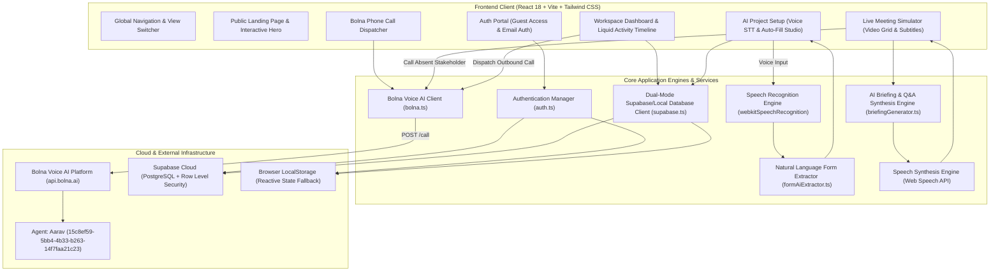
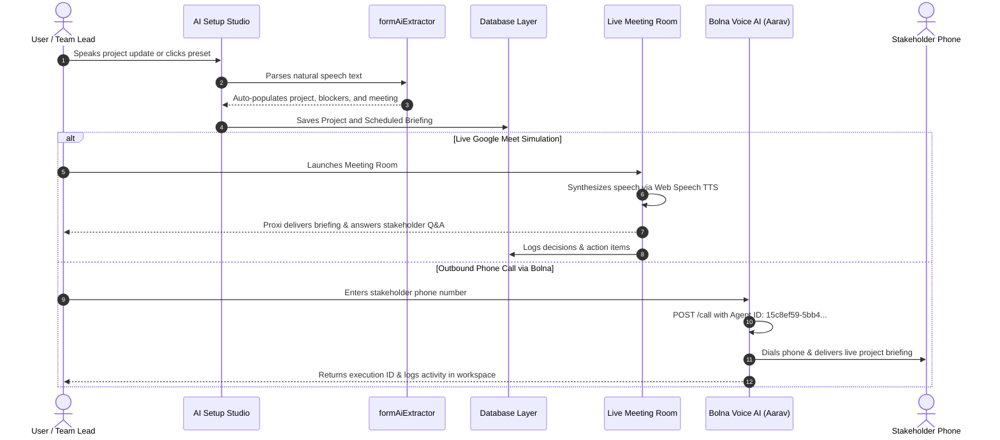

# Proxi — AI That Represents Your Work

> **Proxi** is an intelligent AI meeting representative platform. It joins the calls you cannot, briefs stakeholders with precision, answers questions in real-time, and dispatches automated voice phone calls via **Bolna Voice AI**.

---

## Key Features

### 1. Automated AI Voice & Talk Form Filling
- **Virtual Voice Interviewer**: Users speak or paste project notes naturally; Proxi's conversational extraction engine auto-detects and populates all form fields.
- **Web Speech Recognition**: Powered by browser `SpeechRecognition` for hands-free microphone input.
- **Real-Time Entity Extraction**: Automatically extracts project names, client names, descriptions, latest progress, open blockers, meeting titles, attendees, dates/times, and agendas.
- **1-Click Presets**: Pre-configured prompts for instant demonstration (*Northstar Health*, *Atlas FinTech*, *Meridian Microservices*).

### 2. Bolna Voice AI Integration (`Aarav`)
- **Primary Agent ID**: `15c8ef59-5bb4-4b33-b263-14f7faa21c23` (*Aarav — Proxi AI Assistant*).
- **Outbound Phone Call Dispatch**: Dials any stakeholder's phone number directly via Bolna's API (`POST https://api.bolna.ai/call`).
- **Context-Aware Voice Conversations**: Injects dynamic variables (`user_name`, `project_name`, `progress_summary`, `open_issues`) into Aarav's phone call briefings.
- **Call From Live Room & Dashboard**: Dispatch calls from the Workspace or directly inside the active meeting room if a stakeholder is absent.

### 3. Authentication Portal & 1-Click Guest Access
- **Instant Guest Mode**: 1-click access for evaluators and testers without requiring email or password.
- **Email & Password Authentication**: Full sign-in and sign-up workflows with persistent session management.
- **Protected Routes**: Smooth redirection to the Auth Portal when accessing protected workspace features.
- **Navbar Profile Widget**: Displays user status (`[GE] Guest Explorer` or `[JD] Pro Lead`), account mode, and 1-click sign-out.

### 4. Workspace Dashboard & Liquid Activity Stream
- **Dynamic Liquid KPIs**: Real-time metrics for *Briefings Delivered*, *Engineering Hours Saved*, *Active Blockers*, and *Bolna Voice AI Status*.
- **Real-Time Activity Feed**: Streaming timeline tracking AI briefings, phone calls, decisions, and meeting schedules.
- **Project Context & Risk Studio**: Inline context management for progress summaries, open issues, and health status (`On track`, `At risk`, `Delayed`).
- **AI Briefing Studio**: Real-time generation of executive briefing scripts ready for speech delivery or copying.

### 5. Interactive Live Meeting Room ("Proxi in the Room")
- **Google Meet-Style Video Grid**: Participant tiles for Proxi AI, client stakeholders, tech leads, and the host.
- **Real-Time Speech Synthesis (TTS)**: Proxi speaks briefings out loud via Web Speech API with animated waveforms, glowing speaking rings, and live subtitles.
- **Interactive Stakeholder Q&A**: Simulate stakeholder questions or type custom inquiries; Proxi formulates intelligent, in-character answers based on project context.
- **Meeting Minutes & Decisions Logger**: Captures action items and decisions live during the call and synchronizes them back to the workspace.

### 6. Resilient Dual-Mode Data Layer
- **Supabase Cloud + Local Reactive Store**: Works out of the box with zero external configuration using an in-memory/localStorage PostgREST query builder.
- **Full Offline & Online Parity**: Seamlessly connects to live Supabase PostgreSQL when credentials are provided in `.env`.

---

##  System Architecture



---

## Interaction Flow



---

## Project Structure

```
proxi/
├── .env                              # Active environment variables (gitignored)
├── .env.example                      # Environment variables template
├── .gitignore                        # Git ignore rules (protects credentials)
├── index.html                        # HTML entry point
├── package.json                      # Dependencies and npm scripts
├── postcss.config.js                 # PostCSS configuration
├── tailwind.config.js                # Tailwind CSS configuration
├── tsconfig.json                     # TypeScript configuration
├── tsconfig.app.json                 # TypeScript application configuration
├── vite.config.ts                    # Vite configuration & path aliases
├── src/
│   ├── main.tsx                      # React root entry
│   ├── App.tsx                       # Top-level view routing & global state
│   ├── index.css                     # Global design system & animations
│   ├── types.ts                      # TypeScript definitions (Project, Meeting, User, Bolna)
│   ├── components/
│   │   ├── AuthModal.tsx             # Sign-in, sign-up, and 1-click guest access
│   │   ├── BolnaCallModal.tsx        # Outbound phone call dispatcher via Bolna
│   │   ├── EditProjectModal.tsx      # Project context & blocker editor
│   │   ├── LandingPage.tsx           # Public overview & interactive hero
│   │   ├── MeetingRoom.tsx           # Interactive Google Meet-style AI room
│   │   ├── Navbar.tsx                # Sticky top navigation & user session profile
│   │   ├── NewMeetingModal.tsx       # Additional meeting scheduling modal
│   │   ├── NewProjectModal.tsx       # AI Voice & Talk auto-fill project modal
│   │   └── WorkspaceDashboard.tsx    # Workspace management & liquid activity feed
│   └── lib/
│       ├── auth.ts                   # Authentication & guest session service
│       ├── bolna.ts                  # Bolna Platform API client (Agent 15c8ef59...)
│       ├── briefingGenerator.ts      # Conversational speech and Q&A engine
│       ├── formAiExtractor.ts        # Natural language entity extractor
│       └── supabase.ts               # Dual-engine Supabase & reactive client
└── supabase/
    └── migrations/                   # SQL migrations for projects & meetings
```

---

##  Getting Started

### Prerequisites
- **Node.js** (v18.0.0 or higher recommended)
- **npm** or **pnpm**

### 1. Installation

Clone the repository and install dependencies:

```bash
git clone <repository-url>
cd proxi
npm install
```

### 2. Environment Variables

Create a `.env` file in the project root:

```bash
cp .env.example .env
```

Configure the following variables in `.env`:

```

# Supabase (Optional - Local storage fallback is enabled by default)
VITE_SUPABASE_URL=https://your-project.supabase.co
VITE_SUPABASE_ANON_KEY=your-anon-key-here
```

> [!NOTE]
> Proxi works immediately out of the box with built-in reactive storage. Connecting to Supabase Cloud is optional.

### 3. Development Server

Start the local Vite development server:

```bash
npm run dev
```

Open [http://localhost:5173](http://localhost:5173) in your browser.

---

##  Validation & Testing

Run the full verification suite to ensure code quality:

```bash
# Typecheck
npm run typecheck

# Linter
npm run lint

# Production Build
npm run build

# Preview Production Build
npm run preview
```

---

##  Security & Git Protection

- Sensitive files such as `.env`, `.env.local`, and API keys are strictly excluded from git tracking via `.gitignore`.
- Row-Level Security (RLS) policies are defined in `supabase/migrations/` for database protection.
- The 1-click **Guest Mode** allows complete exploratory access without compromising user credentials.

---

